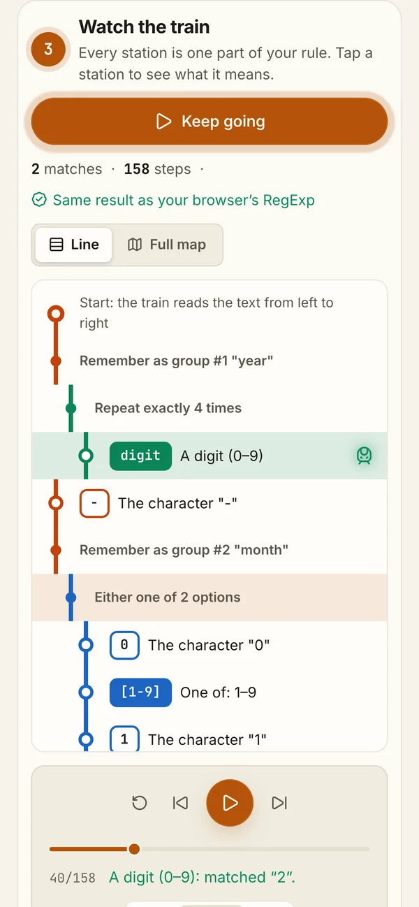

# Regex Railway — see how a regex thinks

A regular expression is a tiny search pattern that looks like gibberish: `(?<year>\d{4})-(?<month>0[1-9]|1[0-2])`. Regex Railway turns it into a metro map, then sends a train through your text one character at a time, so you can watch every decision the engine makes: matches, dead ends and backtracking.




## Features

- **Four simple steps**: 1) write a search rule (or tap an example), 2) give it some text, 3) watch the train, 4) see what it found.
- **Built to be understood**: a "How to read the map" legend, a bubble that explains any station you hover or tap, and plain-English narration for every step.
- **Phone-first line view**: on small screens the map becomes a vertical metro line, read top to bottom, with the train highlighting the current station. The full map is one tap away.
- **Metro-map diagram** on larger screens: stations for characters and classes, branch lines for `|`, loops for repeats, bypasses for optional parts, and a colored line for each capture group.
- **Step-by-step debugger**: play, pause, step and scrub through every attempt. The train turns green on a match, red on a miss and amber when it backtracks. The current character is highlighted in the text.
- **Plain-English narration** for each step ("A digit (0–9): found "r" instead") and an **Explain** tree for the whole pattern. Hovering a line highlights the matching station and the matching piece of the pattern.
- **Errors that point**: a syntax error is underlined at its exact position in the pattern and explained in words.
- **ReDoS detection**: patterns like `^(a+)+$` blow past a step budget and get flagged as catastrophic backtracking, with an explanation and a fix.
- **Verified**: each run is compared with the browser's own `RegExp`, and a badge confirms the result is identical.
- Match list with numbered and named groups, `g i m s` flags, 9 examples, share links, dark and light themes, mobile layout.

## How it works

Nothing here uses the browser's regex engine for the visualization. It is all written from scratch in `src/engine` as plain TypeScript with no React:

| Module       | Job                                                                                                                                                    |
| ------------ | ------------------------------------------------------------------------------------------------------------------------------------------------------ |
| `parser.ts`  | Recursive-descent parser producing a typed AST (discriminated unions) with source spans and friendly errors                                            |
| `matcher.ts` | Backtracking interpreter in continuation-passing style, the same strategy JavaScript uses. It records a trace of every step and stops at a step budget |
| `layout.ts`  | Turns the AST into diagram geometry: stations, tracks, frames, loop notes and a point for the train at every node                                      |
| `explain.ts` | Plain-English description of every node                                                                                                                |
| `tokens.ts`  | Syntax highlighting built from the AST spans, so colors always agree with the parser                                                                   |
| `analyze.ts` | Runs everything once per change and cross-checks the result with the native `RegExp`                                                                   |

Supported syntax: literals and escapes, `.`, `\d \w \s` and their negations, sets with ranges and negation, `^ $ \b \B`, capturing, non-capturing and named groups, `|`, greedy and lazy `* + ? {n} {n,} {n,m}`, backreferences `\1` and `\k<name>`, lookahead and lookbehind. Matching works on UTF-16 code units, like `RegExp` without the `u` flag.

The engine has 92 unit tests, including a suite that compares its matches and capture groups with the native `RegExp` across 48 patterns.

## Run locally

Node.js 24.

```sh
npm ci
npm run dev
```

| Command             | What it does                                                                 |
| ------------------- | ---------------------------------------------------------------------------- |
| `npm run dev`       | Dev server on port 5182                                                      |
| `npm run build`     | Type-check and build into `dist/`                                            |
| `npm run lint`      | ESLint with type-aware rules, zero warnings allowed                          |
| `npm run typecheck` | TypeScript in strict mode                                                    |
| `npm test`          | Engine unit tests (Vitest)                                                   |
| `npm run e2e`       | Playwright tests on desktop and mobile Chrome, with axe accessibility checks |

## Embedding

`?embed=1` hides the intro, the footer and outbound links, for use inside an iframe. `vercel.json` allows framing only from the portfolio domain.

Built by [Harut Andreasyan](https://harut-andreasyan.vercel.app).
